<p align="center">
  
</p>

<h1 align="center">Petit à Petit</h1>

<p align="center">
  <em>A little French every day: listen, review, write and speak.</em>
</p>

<p align="center">
  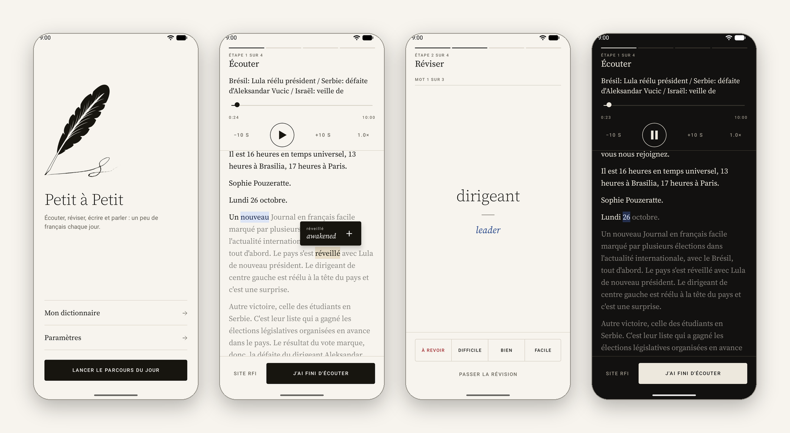
</p>

**Petit à Petit** ("little by little") is an Android app for improving your French with a short daily routine built around the news. You listen to RFI's *Journal en français facile* with a live, word-by-word transcript, tap any word for its English translation, review the words you saved, write a short summary of a story, and then hand that summary to the Gemini app to get it corrected and to start a conversation about it.

The app itself is in French, so everything you touch is practice.

## Features

- **Podcast player** for the latest *Journal en français facile* episode, with background playback, ±10 s skip, seeking and playback speed.
- **Live transcript** that follows the audio and highlights the word being spoken. It auto-scrolls, and pauses auto-scroll as soon as you scroll by hand.
- **Tap-to-translate**: tap any word for its English translation in a small popup, without pausing the audio.
- **Personal dictionary**: save a word from the popup (with the sentence it came from) or add words by hand.
- **Spaced-repetition review** of your saved words, hardest first, before you write.
- **Summary writing** with an automatically saved draft.
- **Gemini hand-off**: a ready-made French prompt that asks for a correction and then a spoken-style discussion.
- **Daily reminder** notification, 18:00 by default and configurable.
- **Light and dark themes**, in a minimalist "ink and paper" design.

## Screenshots

<table>
  <tr>
    <td align="center">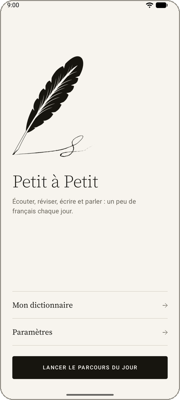<br><sub>Home</sub></td>
    <td align="center">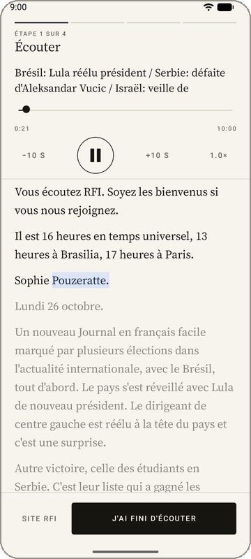<br><sub>Listen, with the live transcript</sub></td>
    <td align="center">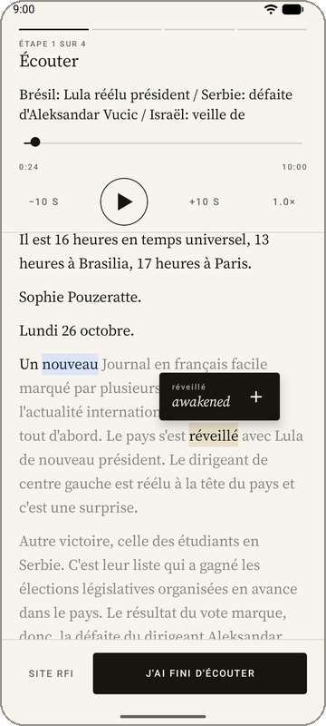<br><sub>Tap a word to translate it</sub></td>
    <td align="center">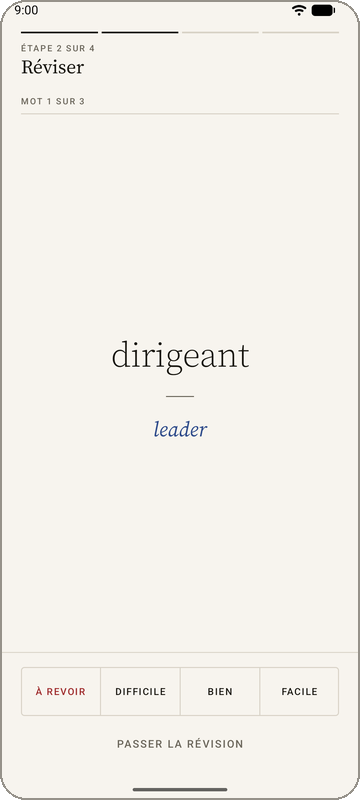<br><sub>Review your words</sub></td>
  </tr>
  <tr>
    <td align="center">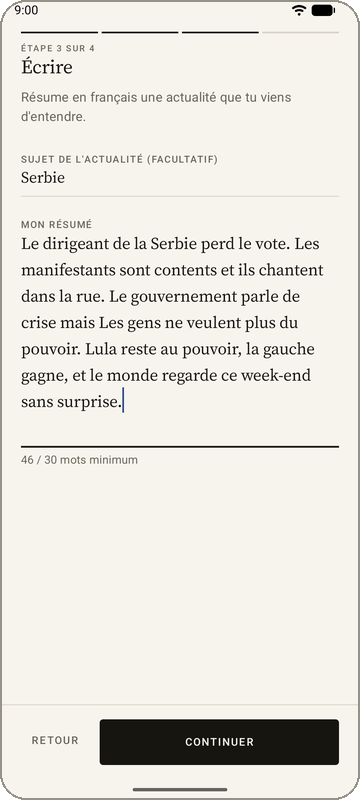<br><sub>Write a summary</sub></td>
    <td align="center">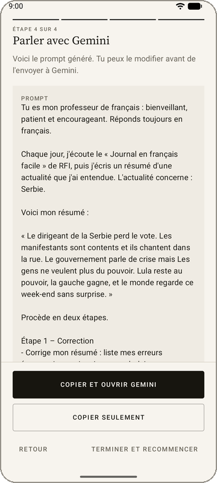<br><sub>Send it to Gemini</sub></td>
    <td align="center">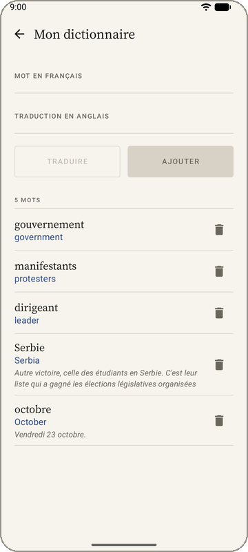<br><sub>Personal dictionary</sub></td>
    <td align="center">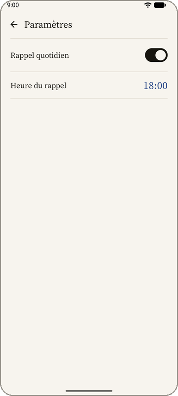<br><sub>Daily reminder</sub></td>
  </tr>
  <tr>
    <td align="center">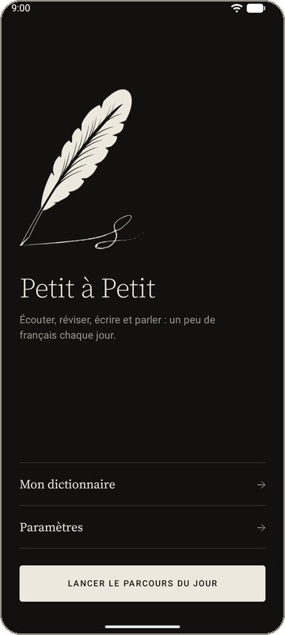<br><sub>Dark theme</sub></td>
    <td align="center">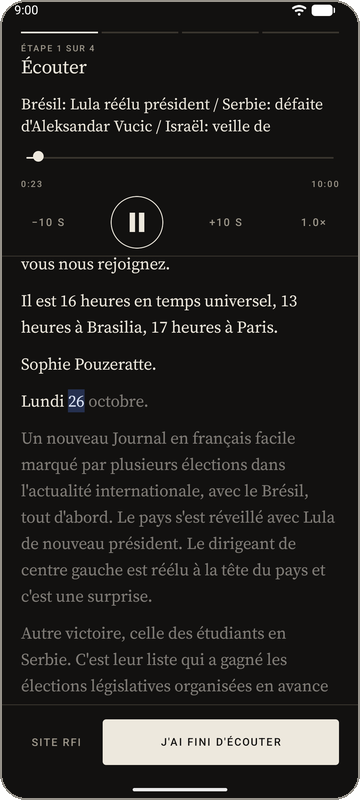<br><sub>Dark theme</sub></td>
    <td align="center">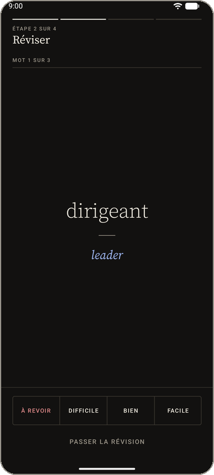<br><sub>Dark theme</sub></td>
    <td></td>
  </tr>
</table>

## The daily routine

Press **Lancer le parcours du jour** on the home screen. The four steps are shown as a thin segmented line at the top of the screen.

1. **Listen.** The latest episode plays in the app, and a link opens it on the RFI website. Tapping a word shows its English translation; the **+** in the popup saves it to your dictionary together with the sentence it appeared in. Tapping the same word again, tapping the popup, or scrolling dismisses it, and it disappears on its own after a few seconds.
2. **Review.** Up to 10 words from your dictionary that are due today (words from today and from earlier days), hardest first. Reveal the translation and answer *À revoir*, *Difficile*, *Bien* or *Facile*. You can skip the review at any time.
3. **Write.** Summarise a story from the episode in at least 30 words. The draft is saved as you type, and every daily run starts with an empty summary.
4. **Speak.** The app builds a prompt (you can edit it), copies it to the clipboard and opens the Gemini app, or its web version if the app is not installed. Paste it in: Gemini corrects your summary first and then starts a conversation, asking one question at a time.

### How the review picks and schedules words

The review uses a simplified SM-2 spaced-repetition scheme:

- Every word has an *ease* and an *interval*. "Bien" gives an interval of 1 day, then 3 days, then it grows by the ease; "Facile" grows faster and raises the ease; "Difficile" stays short and lowers it; "À revoir" counts as a lapse and brings the word back later in the same session.
- A session takes the words that are due today and sorts them by difficulty: many lapses, a low ease, never having been reviewed, or being long overdue all push a word up. The 10 hardest are shown.

## Daily reminder

A notification reminds you to do your French. It is on by default at **18:00**; the switch and the time are in **Paramètres**. On Android 13 and later the app asks for the notification permission.

The reminder uses an inexact alarm, so it needs no special permission but can arrive a few minutes late when the device is in Doze mode. It is scheduled again after a reboot or an app update.

## Design

A minimalist "ink and paper" look, built around the quill of the app icon (`icon.webp`):

- **Palette**: warm paper and ink black, with one muted blue for the word being spoken. The dark theme follows the system setting. Dynamic colour is deliberately off, so the app looks the same on every device.
- **Type**: Source Serif 4 for French content and headings, the system sans for the interface, and small uppercase labels with wide tracking.
- **Components**: hairline dividers instead of cards, underline-only text fields, nearly square corners, a segmented step line, and a hand-drawn play button. They live in [`ui/components/`](app/src/main/java/com/github/bernatbc/petitapetit/ui/components) and the theme is in [`ui/theme/`](app/src/main/java/com/github/bernatbc/petitapetit/ui/theme).
- **Icons**: the adaptive launcher icon (with a themed monochrome layer), the legacy icons, the notification icon and the quill on the home screen are all generated from `icon.webp`.

## Where the data comes from

| What | Source |
| --- | --- |
| Episodes | The podcast RSS feed, `https://francaisfacile.rfi.fr/fr/podcasts/journal-en-français-facile/podcast`. |
| Transcript | Word-level timings from the JSON endpoint used by the RFI website player, `https://francaisfacile.rfi.fr/fr/_ws/media/editions/<episode id>/0`. This is not a documented API and may change. |
| Translation | ML Kit on-device translation (French to English). The model, about 30 MB, is downloaded on first launch. While it is not available, or if it fails, the MyMemory online API is used instead. |

Your dictionary, review progress, settings and summary draft stay on the device. The only data that can leave it is the single word you tap, sent to MyMemory when ML Kit cannot translate it.

## Built with

- Kotlin and Jetpack Compose (Material 3), Navigation Compose
- Media3 (ExoPlayer and `MediaSessionService`) for playback
- ML Kit Translate and the MyMemory API for translation
- DataStore (settings, summary draft) and SQLite (dictionary)
- `minSdk` 24, `targetSdk` 37

## Getting started

You need Android Studio (or the Android command-line tools) with the Android SDK for API 37. Gradle downloads the matching JDK automatically.

```bash
# build and install a debug build on a connected device or emulator
./gradlew installDebug

# unit tests
./gradlew testDebugUnitTest

# Android lint
./gradlew lintDebug
```

An internet connection is needed to fetch the episode and its transcript.

## Project structure

```
app/src/main/java/com/github/bernatbc/petitapetit/
├── data/        RSS feed, transcript, translation, summary draft, dictionary (SQLite), settings
├── domain/      prompt builder, transcript timing, spaced repetition, word lookup, reminder time
├── player/      PlaybackService (Media3 MediaSessionService)
├── reminder/    alarm scheduling, notification and receivers
└── ui/          Compose screens (home, listen, review, write, prompt, dictionary, settings),
                 shared components and the theme
docs/            images used by this README
licenses/        licence of the bundled font
```

## Credits and notices

- The podcast and its transcripts belong to [RFI](https://francaisfacile.rfi.fr/fr/) (*Le français facile avec RFI*). Petit à Petit is an independent project and is not affiliated with or endorsed by RFI or Google. It only plays the public episodes and reads the public transcripts.
- [Source Serif 4](https://github.com/adobe-fonts/source-serif) by Adobe, under the SIL Open Font License 1.1 (see [`licenses/SourceSerif4-OFL.md`](licenses/SourceSerif4-OFL.md)).
- Translations by [ML Kit](https://developers.google.com/ml-kit/language/translation) and [MyMemory](https://mymemory.translated.net/).
